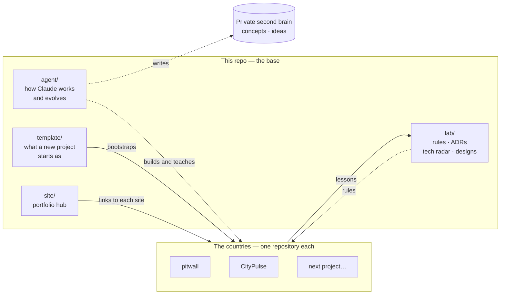

# Data Engineering Lab

Hands-on data engineering projects across clouds and open-source stacks — built to learn deeply and to show the work, by an engineer and an AI teammate.

**Portfolio:** https://tomasripsky.github.io/data-engineering-lab/ — one card per project, each with its own site.

## The world and its countries



This repository is **the base**: the rules every project follows (`lab/`), the AI teammate that builds with me (`agent/`) and the template a new project starts from (`template/`). Each project is an independent **country** in **its own repository** — its code, dependencies, infrastructure, decisions, docs, CI and public site — that can be read, run and torn down on its own ([lab ADR 0007](lab/adr/0007-one-repository-per-project.md)). What a project teaches comes back here as a lesson, a convention or a better template.

## Projects

| Project | What it does | Stack | Status |
|---|---|---|---|
| [pitwall](https://github.com/TomasRipsky/pitwall) | Batch ELT over Formula 1 data (OpenF1 → GCS → BigQuery → dbt → Observable site) that explains race strategy — tyres, pit stops and the undercut — to people who don't follow F1. | Python · GCS · BigQuery · dbt · GitHub Actions · Observable | ✅ v1.0.0 — [dashboard](https://tomasripsky.github.io/pitwall/) |
| [CityPulse](https://github.com/TomasRipsky/CityPulse_Analytics) | Does the weather change how New York rides bikes? Batch ELT over Open-Meteo weather and air quality and 44.5 M Citi Bike trips (GCS → BigQuery → dbt, orchestrated by Airflow 3) — rebuilt from a pre-lab project with the lab's rules. | Python · GCS · BigQuery · dbt · Airflow · Terraform · Observable | ✅ v2.0.0 — [site](https://tomasripsky.github.io/CityPulse_Analytics/) |

The [portfolio hub](https://tomasripsky.github.io/data-engineering-lab/) also shows [MarineFlow](https://github.com/TomasRipsky/marineflow), a streaming project built before the lab and not yet rebuilt with its rules.

## Navigate

| I want to know… | Go to |
|---|---|
| What a project does and how to run it | its repository's `README.md` |
| How a project works inside | its `docs/guide.md` |
| Why a project made a decision | its `docs/decisions/` |
| How a project was designed and planned | its `docs/design/` |
| What a new project starts as | [template/](template/) |
| What a project's site must look like | [template/site/README.md](template/site/README.md), [lab ADR 0008](lab/adr/0008-showcase-site-standard.md) |
| The lab's rules | [lab/conventions.md](lab/conventions.md), [lab/security-and-cost.md](lab/security-and-cost.md) |
| Why the lab is built this way | [lab/adr/](lab/adr/) |
| Which tech we use, try, watch or avoid | [lab/tech-radar.md](lab/tech-radar.md) |
| How the AI teammate works | [agent/](agent/) |

## Built with an AI teammate

Every project here is built with [Claude Code](https://claude.com/claude-code) as a senior engineer and tutor: it designs, builds and explains, and I decide. How that collaboration works — the tutoring loop, the memory, the lessons it has learned and how it changes over time — is documented in [`agent/`](agent/).

## Getting started

```bash
git clone https://github.com/TomasRipsky/data-engineering-lab.git
cd data-engineering-lab
pre-commit install   # enables gitleaks, ruff and branch guards on every commit
```
