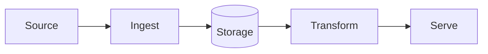

# Project Name

> One-sentence pitch: what problem this solves and for whom.

## Architecture



## Tech stack

| Layer | Choice | Why |
|---|---|---|
| Ingestion | | |
| Storage | | |
| Transformation | | |
| Orchestration | | |

## Run it

```bash
make setup
make test
```

## Cost & teardown

Cloud resources used, expected monthly cost (target: free tier) and how to remove everything:

```bash
make destroy
```

## Docs

- [docs/guide.md](docs/guide.md) — how it works inside.
- [docs/design/](docs/design/) — the spec and implementation plans.
- [docs/decisions/](docs/decisions/) — Architecture Decision Records.
- [site/](site/) — the public site.

Built in the [Data Engineering Lab](https://github.com/TomasRipsky/data-engineering-lab), where the rules every project follows and the AI teammate that builds them are documented.

## What I learned

- Concept — one line on the insight (second-brain note: `02 - Fundamentals/...`).
